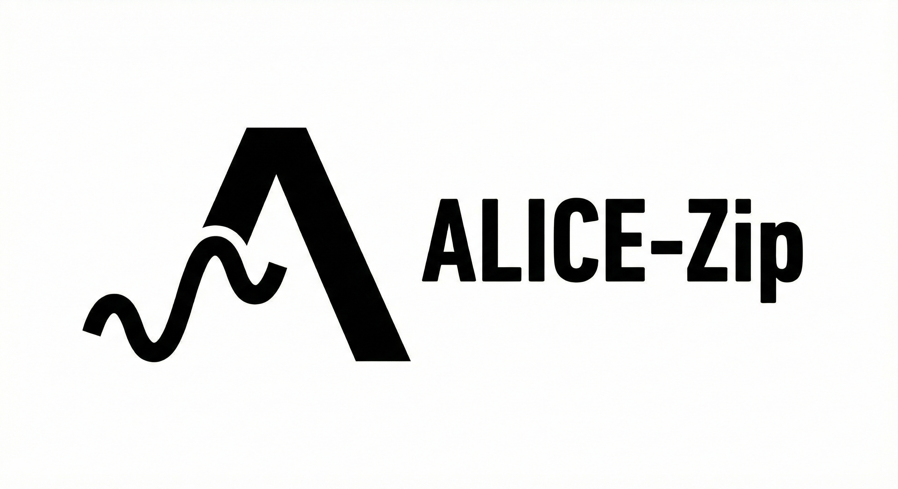

<p align="center">
  
</p>

<h1 align="center">ALICE-Zip</h1>

<p align="center">
  <a href="https://crates.io/crates/alice-zip"></a>
  <a href="https://docs.rs/alice-zip"></a>
  <a href="https://github.com/ext-sakamoro/ALICE-Zip/actions/workflows/ci.yml"></a>
  <a href="https://github.com/ext-sakamoro/ALICE-Zip/actions/workflows/security-audit.yml"></a>
  <a href="https://github.com/ext-sakamoro/ALICE-Zip/actions/workflows/fuzz.yml"></a>
  <a href="#ライセンス"></a>
  <a href="https://python.org"></a>
</p>

> **手続き的生成圧縮エンジン**
> *データではなく、アルゴリズムを保存する*

[English README](README.md)

---

ALICE-Zip は、データそのものではなく**「データの生成方法」**を保存する次世代圧縮ツール

パターン、波形、数学的データに対して**元のサンプルをビット単位で復元したまま 75 倍〜758 倍**、
1e-12 の誤差を許すなら 158 倍〜1166 倍 法則が当たらないデータは byte 圧縮に落ち、
素の zlib と同じサイズに着地します (悪化しません) 本ページの数値はすべて
`cargo run --release --example compression_ratio --features lzma` の出力
<!-- claim-test: the_lossless_container_is_not_worse_than_this_crates_own_zlib_wrapper -->

## 特徴

- **手続き的圧縮:** サイン波、多項式、数学的パターンを認識
- **適応型フォールバック:** 法則が当たらない時は byte をそのまま圧縮する
  素の zlib と比較する試験があるので「標準ツールより悪くならない」は約束でなく検査
- **構成上のビット一致:** 残差をモデルとの **bit の xor** で保存するため、符号付きゼロ・
  非正規化数・モデルよりはるかに小さい値を含めて全ての有限サンプルがそのまま戻る
  旧来の減算残差 (`original - model` を `f32` で計算) は**ビット一致しません** —
  下表のサイン波では零交差近傍の 99 サンプルが失われます
  <!-- claim-test: the_xor_container_is_bit_exact_on_every_law_family_the_readme_quotes -->
- **クロスプラットフォーム:** Python, Rust, C#/Unity, C++/UE5

## リポジトリ構成

| パス | 内容 | 配布先 |
|------|------|--------|
| `/` (`alice-zip`) | **Rust core crate** — 圧縮 primitive (LZ77 / 辞書 / BPE / エントロピー / 量子化 / zlib・LZMA residual container) + 全 generator 法則 (多項式 / Fourier / Perlin)、`no_std + alloc` | [crates.io](https://crates.io/crates/alice-zip) · [docs.rs](https://docs.rs/alice-zip) |
| `libalice/` (`alice-zip-cli`) | CLI `alice`、C FFI (`cdylib`)、PyO3 native module core generators / compression の thin re-export | C# / UE5 binding、`libalice/` から maturin で build する Python module |
| `alice_zip/` | Python package (`ALICEZip` analyzer + `.alice` container) | [PyPI `alice-zip`](https://pypi.org/project/alice-zip/)、native の高速化は [PyPI `libalice`](https://pypi.org/project/libalice/) |
| `bindings/` | C++ / C# (Unity) / UE5 wrapper (`libalice/include/alice.h`) | |

## インストール

```bash
# Python (PyPI); `libalice` is the optional native accelerator
pip install alice-zip libalice

# Rust
cargo add alice-zip                       # std (default): + zlib wrappers
cargo add alice-zip --features fft,parallel,lzma   # rustfft analysis, rayon textures, LZMA residual containers
cargo add alice-zip --no-default-features     # no_std + alloc (sqrt / floor / round via libm)
```

### Rust crate

```rust
use alice_zip::prelude::*;

// Compression primitives (no_std)
let tokens = lz77_encode(b"abcabcabcabc", 256, 32);
assert_eq!(lz77_decode(&tokens)?, b"abcabcabcabc");
assert_eq!(shannon_entropy(&(0..=255u8).collect::<Vec<_>>()), 8.0);

// Generator laws: fit a series, keep the coefficients, regenerate
let series: Vec<f32> = (0..64).map(|i| 3.0 + 2.0 * i as f32).collect();
let (coeffs, degree, err) = fit_polynomial(&series, 4, 1e-6).unwrap();
assert_eq!((degree, generate_polynomial(64, &coeffs) == series), (1, true));

let (bins, dc) = analyze_signal(&generate_sine_wave(32, 1.0, 2.0, 0.0, 0.5), 4, 0.99);
let regenerated = generate_from_coefficients(32, &bins, dc);
# Ok::<(), alice_zip::ZipError>(())
```

| feature | 追加されるもの | default |
|---------|----------------|---------|
| `std` | `compression` (flate2 zlib)、`ZipError` の `std::error::Error` | ✓ |
| `fft` | `generators::analyze_signal_fft` (rustfft、naive DFT と同一契約) | |
| `parallel` | `generate_perlin_2d` / `_advanced` の rayon 行並列 | |
| `lzma` | `compression::{lzma_compress, lzma_decompress}` + `.alice` の量子化 / lossless residual container (lzma-rs) | |
| *(なし)* | `no_std + alloc`、`sqrt` / `floor` / `round` は `libm` (超越関数は全 build で `alice-det-math` 経由)、CI が `thumbv7em-none-eabihf` で rlib build | |

永続化されている係数 convention は 2 つあり、別名で共存する (別の法則なので暗黙に
混用できない): `fit_polynomial` / `generate_polynomial` (`x = 0..n-1`、昇順 —
`alice-db` segment) と `fit_polynomial_unit` / `generate_polynomial_unit`
(`x ∈ [0, 1]`、降順 — `.alice` container) 全法則は閉形式解との突合
([`tests/analytic_oracle.rs`](tests/analytic_oracle.rs)) と fuzz (7 target、
naive DFT ↔ FFT parity 含む) で検証 MSRV 1.87

## クイックスタート

### コマンドライン

```bash
# Compress
alice-zip compress data.bin -o data.alice

# Decompress
alice-zip decompress data.alice -o restored.bin

# Show file info
alice-zip info data.alice
```

### Python API

```python
from alice_zip import ALICEZip
import numpy as np

zipper = ALICEZip()

# Compress sine wave data
data = np.sin(np.linspace(0, 100*np.pi, 100000)).astype(np.float32)
compressed = zipper.compress(data)

print(f"Original: {data.nbytes:,} bytes")
print(f"Compressed: {len(compressed):,} bytes")
print(f"Ratio: {data.nbytes / len(compressed):.1f}x")

# Decompress
restored = zipper.decompress(compressed)
```

### lossless モード (Python)

```python
from alice_zip import ProceduralCompressionDesigner

designer = ProceduralCompressionDesigner()
result = designer.compress(data, enable_lossless=True)
restored = designer.decompress(result)   # same dtype, same bytes as data
```

- `decompress` は実数の十一種の dtype (`float16/32/64`、`int8`〜`int64`、`uint8`〜`uint64`) で、NaN の payload や無限大を含めて入力を dtype ごと bit 単位で返す <!-- claim-test: test_lossless_gives_back_the_input_bit_for_bit -->
- residual は元データから書き、元データの精度で持つ (float64 / int32 / uint32 / int64 / uint64 の元データは `float64`、それ以外は `float32`) 生成値と residual で正確に復元できない値 (NaN、無限大、差が正確でない値) はそのまま持つ residual は `ResidualData` の file で version 4 (residual が `float32` でそのまま持つ値が無ければ version 2)
- parameter と residual の合計が入力の LZMA より小さくなければ LZMA の結果を返す residual が運べない dtype (complex など) も同じ <!-- claim-test: test_a_lossless_result_is_not_larger_than_lzma_of_the_input -->
- `quantize_residual=8` / `16` は lossy (`is_lossless` は `False`) で、各値の誤差は量子化の半 step に、`float32` で持つ residual の丸めと出力 dtype への丸め (それぞれ最後の桁の半分) を足した範囲に収まる residual の幅が小さい `float32` のデータでは丸めの項が半 step よりずっと大きくなり、半 step は上界にほとんど効かない <!-- claim-test: test_a_quantized_residual_is_off_by_at_most_half_a_step -->
- 以前の版で作った結果 (`float32` の residual で lossless でなかったもの) は `decompress` が拒否する 入力から圧縮し直すか、近似値でよければ `allow_approximate=True` で読む <!-- claim-test: test_a_result_of_the_earlier_residual_path_is_refused -->

## 仕組み

従来の圧縮は**バイト列**のパターンを探す ALICE は**数学的**パターンを探す

```
Original Data = Generated(parameters) ^ Residual

Where:
  - Generated()  = Mathematical function (polynomial, sine wave, etc.)
  - parameters   = Tiny description (tens of bytes)
  - Residual     = Compressed bit-pattern xor against Generated()
                   (mostly zero bytes when the law is a good fit)
```

xor であることが厳密な復元の根拠です 差 (`original - model`) を `f32` で計算すると、
元の値がモデルよりはるかに小さい箇所で元の値が丸めで消えるので `model + residual` は
元に戻りませんが、`bits ^ bits` にはその経路がありません

### 例

```
Input:  Sine wave, 100,000 samples (400,000 bytes of f32)
        ↓
Analysis: one Fourier coefficient — "freq bin 50, amp 1.0, phase 0"
        ↓
Output: 20 bytes of parameters + 5,306 bytes of compressed xor residual
        ↓
Result: 400,000 -> 5,358 bytes = 75x, and the samples come back bit for bit
        (plain zlib on the same bytes: 8,742 -> 45.8x)
```

パラメータ 20 バイトだけを残せば 20,000 倍ですが、それは最大絶対誤差 1.8e-7 の
**近似**であって復元ではありません 下のベンチマーク表では両方を別の列に置いています
前者を「ロスレス」と並べて書くと結果を 2 桁以上大きく見せることになるためです

### 証拠つきの法則 (`law` module)

`law::SignalLaw` は当てはめた多項式を、元になった証拠 (点列)、測った残差、証拠が覆う `x` の範囲、出典、再現すべき参照値と一緒に持つ 新しい条件で再計算できるが範囲外へは外挿しない 新しい証拠は追記せず判定する

```rust
use alice_zip::law::{IngestPolicy, Provenance, SignalLaw, Verdict};

let pts: Vec<(f64, f64)> = (0..5).map(|i| (i as f64, 1.0 + 2.0 * i as f64)).collect();
let law = SignalLaw::fit_polynomial(&pts, 1, Provenance::new("bench run 1", "least squares"))?;
assert!((law.evaluate(2.5)? - 6.0).abs() < 1e-12); // a condition that was not measured
assert!(law.evaluate(9.0).is_err());               // outside the measured range

let policy = IngestPolicy { abs_tolerance: 0.01, break_factor: 4.0 };
assert!(matches!(law.ingest(&[(0.5, 2.0), (3.5, 8.0)], &policy), Verdict::Supports { .. }));
# Ok::<(), alice_zip::law::LawError>(())
```

| 判定 | 条件 |
|------|------|
| `Supports` | 新しい点が許容幅の中で法則と一致する |
| `ParameterUpdate` | 同じ形で旧と新の点を合わせて当てはまり、パラメータだけが変わる (当てはめ直した法則を返す) |
| `ResidualGrew` | ずれが許容幅を超えるが、その `break_factor` 倍以内 |
| `Breaks` | 新しい点はこの形では説明できない |
| `OutOfRange` | 当てはめた範囲の外の点がある 何も判定しない |

規則と順序は module の doc に書き、[`tests/analytic_law.rs`](tests/analytic_law.rs) で固定している

#### 法則を内容で識別する

`SignalLaw::law_id` は法則の 32 byte の識別子を返す 保存した結果が「どの法則から出たか」を名指しできる

```rust
use alice_zip::law::{Provenance, SignalLaw};

let pts: Vec<(f64, f64)> = (0..5).map(|i| (i as f64, 1.0 + 2.0 * i as f64)).collect();
let law = SignalLaw::fit_polynomial(&pts, 1, Provenance::new("bench run 1", "least squares"))?;

// 32 bytes identifying what the law is evaluated with. For a law evaluated
// through this crate that is `law::SEMANTICS_ID`, alice-zip's own identifier
// (it folds alice-det-math's); pass another value only if another arithmetic is used.
let id = law.law_id(&alice_zip::law::SEMANTICS_ID);
# Ok::<(), alice_zip::law::LawError>(())
```

digest に入るのは `evaluate` が読むもの (有効範囲と係数) と `semantics_id` だけ 証拠・残差・出典・oracle case は意図的に外してある それらは法則をどう得てどう正当化したかの記録で、法則が何を計算するかではないので、同じ法則を別の測定から当てはめても識別子は 1 つになる

**保証する**: 識別子が同じなら、IEEE 754 の基本演算が成り立つどの target でも `evaluate` は全ての `x` で同じ bit を返す
<!-- claim-test: equal_law_id_implies_bit_identical_evaluation -->

この保証があるため、float の超越関数は platform ではなく `alice-det-math` から取る IEEE 754 は `sin` / `cos` / `atan2` / `log2` に正確丸めを要求しないので、platform 版は OS / CPU / compiler で違いうる `std` feature だけを変えた同一機での実測では、0.5 系は `generate_multi_sine` が 64 sample のうち 1、`analyze_signal` が 9 field のうち 6 で別の bit を返した `tests/determinism_golden.rs` が bit 配列を記録し、CI が 3 OS と `no_std` build で走らせる `clippy.toml` が platform の method を拒否するので逆流しない `sqrt` / `floor` / `round` は IEEE 754 が結果を 1 通りに定めるので platform のままにしている
<!-- claim-test: sinusoid_generators_are_the_recorded_bits -->

**保証する**: 復元の法則は 1 つの実装しか持たない `sine_at` / `multi_sine_at` / `fourier_at` / `polynomial_at` が 1 点 (非整数でよい) での値を返し、配列生成器はその `map` なので、範囲読み出しと 1 sample の読み出しが食い違うことがない 単点問い合わせに答える側はこれを呼び、法則の写しを持たない 0.7.0 より前は crate の外に写しがあり、sine で 1024 sample のうち 788 が不一致だった 法則は `f64` で積んで 1 度だけ丸める形にした 2 つの形のうちこちらが正確な方 (`f64` の閉形式に対する最大誤差は 5.95e-8、もう一方は 9.16e-7)
<!-- claim-test: array_generators_are_a_map_over_the_point_law -->

**保証しない**: その逆 評価が同じでも識別子は分かれうる 末尾に 0 の係数を足した場合が最も単純な例 法則を正規形に落とすのは別の問題なので、識別子は重複排除の鍵には使えない
<!-- claim-test: evaluation_equivalent_laws_may_still_differ_in_id -->

byte 配置は `law_id` の doc に書き、CI が対応 target すべてで再現する golden digest で固定している 独立の実装が同じ識別子を計算できる
<!-- claim-test: law_id_golden -->

浮動小数は生の bit で入り、`-0.0` は `+0.0` に畳まない 1 次の係数が負なら、定数項の零の符号が範囲の下端の結果に現れるので、畳むと評価の異なる法則に同じ識別子を与えることになる
<!-- claim-test: negative_zero_is_observable_in_evaluation_so_it_changes_the_id -->

### 内容ハッシュつきコンテナ (`container` module)

`container::Container` は複数の payload を 1 つの file にまとめ、それぞれを
SHA-256 で識別する section は既存の形式の bytes をそのまま運ぶので、中身の
形式は自分の版を持ち続ける コンテナが決めるのは header / section 表 / file の
整合性だけ

- **識別子**: `Container::id` は header と section 表 (各 payload の SHA-256 を
  含む) の SHA-256 domain 分離と長さ前置は `law::SignalLaw::law_id` と同じ符号化
- **整合性**: 末尾 32 byte はそれより前の全 byte の SHA-256 で、読み手は必ず
  検証する 各 payload の SHA-256 は読む時に検証するので、`ContainerView` は
  他の section を hash し直さずに 1 つだけ返せる
- **版**: major が 1 以外は拒否、minor は何でも読む 未知の tag の section は
  critical なら拒否、そうでなければそのまま保持するので、読んで書き戻すと同じ
  bytes になる
- **形式の識別子**: section 0 は critical な `FMID` section で、形式の定義の
  SHA-256 である `container::FORMAT_ID` を持つ これより前の読み手 (0.10 以前) は
  自分の形式として読まずに拒否する この section の無い container (0.10 以前が書いたもの) は
  読めて `FormatStatus::Legacy` と報告され、`Container::from_bytes_strict` は拒否する
  別の値の `FMID` は `ContainerError::UnknownFormat` section の番号は `FMID` を
  0 番と数える <!-- claim-test: every_reference_fixture_carries_the_identifier_first -->
- **参照**: `SREF` section は他の section を SHA-256 で指すので、何度使う
  payload も 1 回だけ置かれ、無い section への参照は拒否される `LIDS`
  section は法則の識別子を並べ、header の semantics id と、
  `ContainerView::verify_law_ids` を通して payload から再計算した識別子と照合する
- **法則の識別子を信用する読み手**: container はどの算術の下でも読める
  (`Container::from_bytes` / `ContainerView::law_ids` / `law_ids_unchecked_semantics`
  は構造だけを見るので、古い版が書いた file を読んで移行できる) 法則の識別子を
  この build の bit についての主張として使えるのは
  `ContainerView::law_ids_for_this_arithmetic` と `verify_law_ids` を通した時だけで、
  header の semantics id を実行中の `alice-det-math` が再現できること
  (`check_semantics(..).is_reproducible()`) を求め、できなければ行を比べる前に
  `ContainerError::NotThisArithmetic` で拒否する <!-- claim-test: a_container_stamped_by_0_4_0_opens_but_its_law_ids_are_not_trusted -->
- **以前の file**: `container::read_any` は版 1.0 / 1.1 の `ALICE_ZIP` file も
  読み (header と payload の 2 section)、書かれたことのない値は拒否する
  `container::decompress_legacy_alice_zip` (`lzma` feature) は Python の書き手が
  LZMA に退避した payload (元データをそのまま再現する唯一の種類) を復元し、header の
  `original_size` と `original_hash` に照合する 受け入れる `original_size` の上限は
  呼び出し側が渡し、展開の前に xz の chunk の大きさを `original_size` と照合するので、
  小さな payload がメモリ上で膨らむことはない (最大のメモリは受け入れた大きさのおよそ 2 倍) procedural の payload は生成器の
  parameter なので Python package だけが復元する <!-- claim-test: python_lzma_fallback_files_decode_to_the_original_bytes -->

<!-- claim-test: every_single_bit_flip_is_refused_by_the_expected_check -->
コンテナのどの 1 bit を変えても拒否される (5 section の fixture の全 bit で確認)
bytes と識別子は独立の参照実装と Linux / macOS / Windows / `wasm32-wasip1` で
一致する (`tests/container_oracle.rs`、`tests/data/container/container_ref.py`)

```rust
use alice_zip::container::{read_any, Container, Tag};

let mut c = Container::new([0; 32]);
c.push(Tag::RAW, true, b"payload".to_vec());
let bytes = c.to_bytes();
assert_eq!(read_any(&bytes)?, c);
# Ok::<(), alice_zip::container::ContainerError>(())
```

### 整数 2 次元の残差 (`int2d` module)

`int2d` は整数の格子 (存在の mask つき) か整数の点の集合の上の `i64` の値を、
整数の法則に対する残差として保存する 予測・残差・符号化はすべて整数演算で、
同じ入力はどの target でも同じ bytes になり、overflow は wrap せず error になる

- **法則**: `IntLaw2::predict(i, j)` は正確な `i64` を返す `Zero` は 0 を予測し、
  `PlanePerTile::fit` は tile ごとに最小二乗の平面を `i128` で解き、係数は `2^-k`
  の倍数、tile の辺は座標の単位 呼び出し側は自分の曲面を実装できる fit した法則は
  archive とは別に `PlanePerTile::to_bytes` / `from_bytes` で保存する (`from_parts`
  でも組み直せる) archive は法則を識別子でしか名指さないため
- **mode**: `Mode::Lossless` はすべての値を保ち、`Mode::Bounded { q }` は残差を
  `q` の倍数に丸め (半分は上へ)、最大の誤差 (高々 `q / 2`) を返す
- **archive** (`std` feature): `encode` / `decode` は法則の識別子、domain の
  digest、mode、件数、元の値と復元した値の SHA-256、archive 全体の SHA-256 を
  書いて確かめる 残差は既定で deflate し、`encode_with(.., Codec::Raw)` は別の
  backend のために varint を圧縮せずに置く
- **識別子**: `IntLaw2::law_id` は `law::SignalLaw::law_id` と同じ SHA-256 の
  符号化で、semantics id を含まない (浮動小数点を使わないため)

<!-- claim-test: archive_bytes_are_the_recorded_ones -->
固定の入力に対する archive の bytes を記録し、Linux、macOS、Windows で確かめる
(`tests/int2d_oracle.rs`)

```rust
use alice_zip::int2d::{decode, encode, Domain, Mode, PlanePerTile};

let domain = Domain::lattice(0, 0, 4, 4, None)?;
let values: Vec<i64> = (0..16).map(|k| 3 * k - 5).collect();
let law = PlanePerTile::fit(&domain, &values, 4, 8)?;
let enc = encode(&domain, &values, &law, Mode::Lossless)?;
assert_eq!(decode(&enc.bytes, &domain, &law)?, values);
# Ok::<(), alice_zip::int2d::Int2dError>(())
```

## ベンチマーク

100,000 個の `f32` サンプル (400,000 バイト)、deflate level 9
再現は `cargo run --release --example compression_ratio --features lzma`
`zlib alone` 列は同じ byte 列を本 crate の zlib wrapper に同じ level で通したもので、
フォールバックが並ばなければならない床です

**ビット一致** (法則のパラメータ + xor 残差、サンプルがそのまま戻る):

| データタイプ | 圧縮後 | 圧縮率 | ビット一致 | zlib alone |
|-------------|--------|-------|-----------|----------|
| サイン波 | 5,358 B | **75倍** | はい | 8,742 B (45.8倍) |
| 多項式 (3次) | 3,948 B | **101倍** | はい | 330,123 B (1.2倍) |
| 線形グラデーション | 528 B | **758倍** | はい | 293,616 B (1.4倍) |
| ランダムデータ | 364,677 B | 1倍 | はい | 364,641 B (1.1倍) |

<!-- claim-test: the_xor_container_is_bit_exact_on_every_law_family_the_readme_quotes -->

**非可逆** (誤差の上限を受け入れられる場合):

| データタイプ | パラメータのみ | 圧縮率 | 最大絶対誤差 | 量子化残差 (16bit) | 圧縮率 | 最大絶対誤差 |
|-------------|--------------|-------|------------|------------------|-------|------------|
| サイン波 | 20 B | 20,000倍 | 1.8e-7 | 2,107 B | 190倍 | 1.4e-12 |
| 多項式 (3次) | 36 B | 11,111倍 | 6.0e-8 | 2,532 B | 158倍 | 9.1e-13 |
| 線形グラデーション | 20 B | 20,000倍 | 7.5e-9 | 343 B | 1,166倍 | 5.0e-14 |
| ランダムデータ | 4 B | 100,000倍 | 1.0e0 | 200,094 B | 2倍 | 1.5e-5 |

表の読み方:

- **ランダムデータはフォールバックが働いている状態** 法則が当たらないので信号全体が
  byte 圧縮を通り、結果は素の zlib と 36 バイト差で並ぶ フォールバックの目的は
  勝つことではなく負けないこと
- **パラメータのみの列は復元ではない** 20,000 倍は法則のサイズで、誤差列がその代償
- **xor 容器が買うのは厳密性でサイズではない** 旧来の減算残差も利用可能
  (`compress_residual_lossless`) で、多項式では小さく (2,815 B vs 3,948 B)、短い信号では
  サイン波でも逆転する (4,096 サンプルでは減算側が小さい) が、ビット一致しない
  サンプルをそのまま戻す必要があるなら `compress_residual_xor`、誤差の上限を許せて
  サイズが要るなら減算側を選ぶ
- **残差容器はどれも model の semantics 識別子を記録する** (32 byte、この crate の
  法則で評価した model なら `law::SEMANTICS_ID`) 復元側は記録された識別子を
  `law::check_semantics` で照合し、それ以外は復元の前に両方の識別子を示す
  `compression::ResidualIdError::Mismatch` で拒否する 0.10 以前が書いた容器も復元でき
  (`residual_container_status` は `Legacy` を返し、`*_strict` の復元は拒否する)
  CLI crate と Python package が値を再生成する独自の file (残差 file、procedural の
  `ALICE_ZIP` payload、`ALICE_IMG` / `ALICE_AUD` / `ALICE_VID` の parameter) も同じく算術を
  `"semantics"` に記録する <!-- claim-test: another_identifier_is_refused_naming_both_before_decoding -->

## 最適なユースケース

- **科学データ:** シミュレーション出力、センサー読み取り、波形
- **ゲームアセット:** 手続き的テクスチャ、地形ハイトマップ
- **IoT/エッジ:** 帯域制限のあるデバイスのセンサーログ
- **時系列:** テレメトリ、パターンのある監視ログ

## 使うべきでない場面

| データタイプ | 理由 |
|-------------|------|
| JPEG/PNG/MP3 | 既に圧縮済み |
| ランダム/暗号化データ | パターンがない |
| 小さなファイル (<1KB) | ヘッダーのオーバーヘッド |

## ソースからビルド

```bash
git clone https://github.com/ext-sakamoro/ALICE-Zip
cd ALICE-Zip

# Install Python package
pip install -e .

# Run tests
pytest tests/ -v

# Rust core crate — every CI gate, locally (scripts/preflight.sh --quick ≈ 3 min)
scripts/preflight.sh

# CLI / FFI crate
cargo build --manifest-path libalice/Cargo.toml --release
```

## 関連プロジェクト

同じ考え方を別の領域に当てたもの 本 crate は*信号*の作り方を保存し、こちらは形・物理状態・frame の作り方を保存する

| プロジェクト | 内容 | リンク |
|---------|-------------|-------|
| **ALICE-SDF** | 3D の形を polygon でなく法則で持つ — GLSL / WGSL / HLSL への変換、SVO、marching cubes、platform をまたいで bit 一致の評価 | [crates.io](https://crates.io/crates/alice-sdf) · [docs.rs](https://docs.rs/alice-sdf) · [GitHub](https://github.com/ext-sakamoro/ALICE-SDF) |
| **ALICE-DetMath** | 本 crate の Fourier / Perlin generator と ALICE-SDF が共に評価する bit 一致の超越関数層 (`sin` / `exp` / `atan2` / …) 同じ法則がどの platform でも同じ bit を出す | [crates.io](https://crates.io/crates/alice-det-math) · [docs.rs](https://docs.rs/alice-det-math) · [GitHub](https://github.com/ext-sakamoro/ALICE-DetMath) |
| ALICE-DB | model ベースの時系列 database | [crates.io](https://crates.io/crates/alice-db) · [GitHub](https://github.com/ext-sakamoro/ALICE-DB) |
| ALICE-Edge | 組込み / IoT 向けの model generator (`no_std`) | [crates.io](https://crates.io/crates/alice-edge) · [GitHub](https://github.com/ext-sakamoro/ALICE-Edge) |
| ALICE-Streaming-Protocol | 超低帯域の映像 streaming | [crates.io](https://crates.io/crates/libasp) · [GitHub](https://github.com/ext-sakamoro/ALICE-Streaming-Protocol) |
| ALICE-Eco-System | Edge から Cloud までの pipeline の demo | [GitHub](https://github.com/ext-sakamoro/ALICE-Eco-System) |

どれも同じ考え方を共有する: **データそのものでなく、生成の手順を符号化する**

<!-- law-integration:begin law=5c6363312520f9991837e519bab14909ccf6f2b3 -->
## ALICE-Law との統合

ALICE-Law の `scripts/gen-law-readme-block.py` が ALICE-Law `5c6363312520` とこの repository の `alice-law-conformance.toml` から生成する 手で編集しない

| | |
|---|---|
| release train | alice-zip 0.10.0 (published)、Law への依存: あり |
| 算術 | train の alice-det-math 0.5.0、算術の識別子 `135c407d4249c1c200e4d1be79a12e848ce5c355fc3a918da965849e697ef000` この crate の要求は `alice-det-math = "0.5.1"` |
| end to end 検査 | 対象 (`alice-zip = "0.10"`)、digest `966a78784bb4e3341ac6627d519db896f398176b71c2402b188294db6c8e3728`、aarch64 と x86_64 で同じ |

### 適合 (G1-G14)

| gate | 状態 | 注記 |
|---|---|---|
| G1 no-libm-direct | 適合 | every method the G1 list marks banned is in clippy.toml, the pending powi is banned, every feature and the no_std target are linted with -D warnings, and the … |
| G2 ieee-max-min | 適合 | met for the Rust crates (alice-zip and libalice). The Python package computes no max / min that feeds a stored identifier. |
| G3 no-outer-fneg-of-fma | 未達 | no library source calls `mul_add`/`fma` at all (src/generators/polynomial.rs:63 is a doc comment deliberately keeping Horner as separate multiply-and-add … |
| G4 debug-release-arch-goldens | 適合 | the debug legs and the release goldens existed since the G14 work (release-profile.yml); the release step with every feature is added here, so the lzma, fft … |
| G5 release-profile-test-leg | 適合 | an aarch64 release-only divergence (contraction into fma, reassociation) fails macos-latest. |
| G6 semantics-id | 適合 | the identifier moves when a pinned output, a tag or the det-math generation moves, not with the crate version. The law identifier goldens are not entries: they … |
| G7 handshake-carries-id | 適合 | the published crate's only type-erasing boundaries that receive a Law-bearing identifier are the container decode paths (serialized bytes / file; the crate has … |
| G8 persisted-semantics-id | 適合 | The writers of the whole repository are covered, by the test whether decoding regenerates values from a law or parameters. Crate alice-zip: … |
| G9 persisted-meaning-change-is-major | 適合 | the identifier moves in this crate's history are recorded as breaking releases naming both ids. 0.11.0 (CHANGELOG.md [Unreleased], Breaking, ALICE-Law G6): … |
| G10 no-run-varying-artifacts | 適合 | the Python package has no other unseeded randomness, clock or UUID (a scan of alice_zip/ finds only RandomState(seed) at media_generators.py and … |
| G11 gate-self-tests | 未達 | unmet: clause (c). scripts/clippy_canary.py, scripts/test_clippy_canary.py, scripts/gen_clippy_canary_calls.py, scripts/test_gen_clippy_canary_calls.py, … |
| G12 public-repo-text-rules | 適合 | the public-text.yml job runs scripts/public_text.sh, which fetches ALICE-Law's own scripts/public_text_check.py at the revision .github/public-text-pin names … |
| G13 no-unspecified-order | 適合 | libalice (alice-zip-cli, a separate crate in this repository that preflight lints with the same clippy.toml) reads its JSON header into a BTreeMap (keyed … |
| G14 float-environment-invariants | 適合 | the static scan covers the files of this repository (libalice/ included) and the dynamic check covers the alice-zip builds CI runs on ubuntu and macOS; a flag … |

### feature と保証の範囲

| feature | 保証 | 注記 |
|---|---|---|
| `fft` | 範囲外 | fft enables rustfft-backed generators::analyze_signal_fft, a DIFFERENT algorithm (O(n log n)) from the naive DFT analyze_signal, and rustfft computes its own … |
| `lzma` | 範囲内 | lzma enables LZMA + the `.alice` residual containers (compression::{lzma_*, *_residual_*}); it is lossless byte compression with no Law float arithmetic of its … |
| `parallel` | 範囲外 | parallel swaps the 2D Perlin row loop (generate_perlin_2d / generate_perlin_advanced, src/generators/perlin.rs:204-207) from a serial flat_map to rayon … |
| `std` | 範囲内 | std enables the `compression` module (zlib via flate2) and `std::error::Error` for ZipError; it is lossless byte coding with no Law float arithmetic of its … |
<!-- law-integration:end -->

## ライセンス

- [Apache License, Version 2.0](LICENSE-APACHE): Rust core crate `alice-zip` (`/`)、
  CLI / FFI crate と Python の wheel (`libalice/`)、Python package (`alice_zip/`)、bindings
- 再配布 (source でも binary でも) には [LICENSE-APACHE](LICENSE-APACHE) と
  [NOTICE](NOTICE) を添える (Apache-2.0 第 4 条) application の画面に表示する必要は無い
- それより前の版は出した時のライセンスのまま: crates.io の `alice-zip` 0.8.0 までは
  MIT OR Apache-2.0、crates.io の `alice-zip-cli` (libalice) 2.6.0 までと git の libalice
  2.7.0 までは MIT、git から入れる Python package (PyPI には無い) の 1.0.0 までは MIT
- 「ALICE」の名前はライセンスによらず [TRADEMARK_NOTICE](TRADEMARK_NOTICE) の対象
- `libalice-enterprise/`: 別建ての非公開 proprietary crate (同 dir の [LICENSE](libalice-enterprise/LICENSE) 参照)

## 作者

**坂本師哉** (Moroya Sakamoto)

---

*「最良の圧縮とは、データを保存することではなく、それを生成するレシピを保存することである」*
